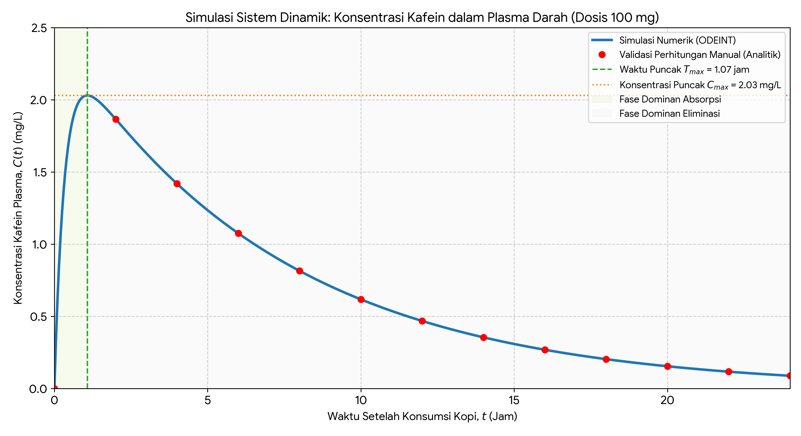
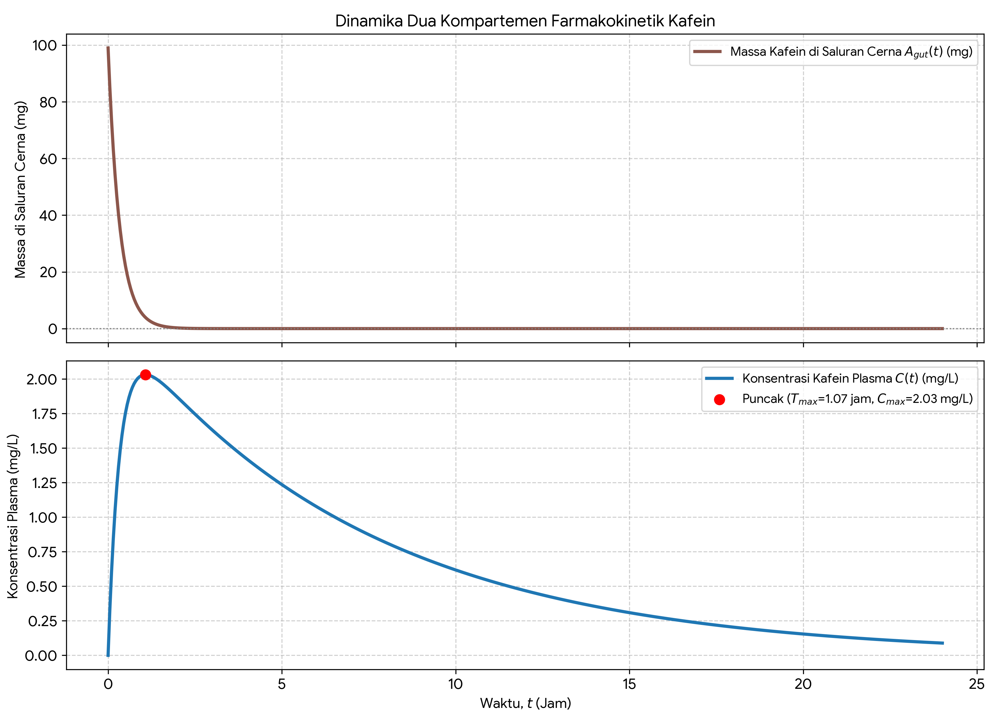
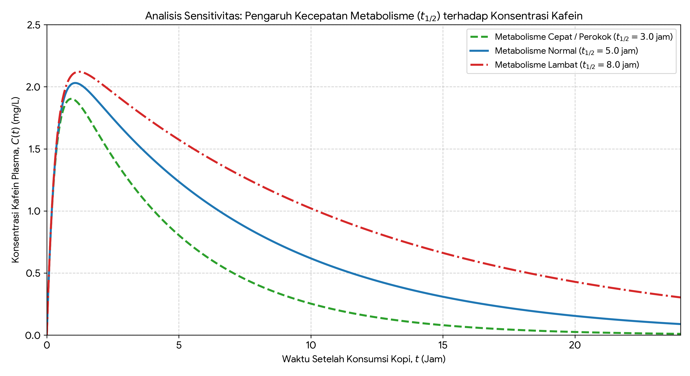

# ☕ Pemodelan dan Simulasi Sistem Dinamik: Konsentrasi Kafein dalam Darah

[](https://colab.research.google.com/)


Repositori ini berisi implementasi **Pemodelan dan Simulasi Sistem Dinamik** untuk memprediksi dinamika konsentrasi kafein dalam plasma darah setelah konsumsi kopi menggunakan **Model Kompartemen Absorpsi dan Eliminasi Orde Satu** (*One-Compartment First-Order Absorption & Elimination Pharmacokinetic Model*).

---

## 📋 Daftar Isi
- [Identitas Mahasiswa](#-identitas-mahasiswa)
- [Deskripsi Studi Kasus](#-deskripsi-studi-kasus)
- [Formulasi Matematis (ODE & Analitik)](#-formulasi-matematis-ode--analitik)
- [Parameter Farmakokinetik](#-parameter-farmakokinetik)
- [Hasil Visualisasi & Simulasi](#-hasil-visualisasi--simulasi)
- [Tabel Perhitungan Manual vs Simulasi Python](#-tabel-perhitungan-manual-vs-simulasi-python)
- [Struktur Repositori](#-struktur-repositori)
- [Cara Menjalankan di Google Colab / Lokal](#-cara-menjalankan-di-google-colab--lokal)

---

## 👤 Identitas Mahasiswa
* **Nama:** Sigit Miraj Permana
* **NIM:** 301240037
* **Program Studi:** Teknik Informatika — Fakultas Teknologi Informasi, Universitas Bale Bandung (UNIBBA)
* **Mata Kuliah:** Pemodelan dan Simulasi (Semester 5)
* **Dosen Pengampu:** Pak Bayu

---

## 📖 Deskripsi Studi Kasus
Ketika seseorang meminum secangkir kopi ($\pm 240\text{ mL}$ mengandung $100\text{ mg}$ kafein), molekul kafein tidak seketika muncul seluruhnya di dalam darah. Proses yang terjadi di dalam tubuh merupakan sistem dinamik kontinu yang terdiri atas dua laju perubahan:
1. **Laju Absorpsi ($k_a$):** Perpindahan kafein dari saluran pencernaan ($A_{\text{gut}}$) menuju sirkulasi plasma darah.
2. **Laju Eliminasi ($k_e$):** Pembersihan kafein dari plasma darah melalui metabolisme hati (enzim CYP1A2) dan ekskresi ginjal.

Simulasi ini memodelkan kurva konsentrasi kafein plasma $C(t)$ selama **24 jam** untuk mengidentifikasi **waktu puncak ($T_{\text{max}}$)**, **konsentrasi puncak ($C_{\text{max}}$)**, serta pengaruh variasi kecepatan metabolisme tubuh ($t_{1/2}$).

---

## 🧮 Formulasi Matematis (ODE & Analitik)

### 1. Sistem Persamaan Diferensial Biasa (ODE)
$$\frac{dA_{\text{gut}}(t)}{dt} = -k_a \cdot A_{\text{gut}}(t)$$

$$\frac{dC(t)}{dt} = \frac{k_a \cdot A_{\text{gut}}(t)}{V_d} - k_e \cdot C(t)$$

### 2. Solusi Analitik (Persamaan Bateman)
Dengan kondisi awal $A_{\text{gut}}(0) = F \cdot D$ dan $C(0) = 0$, solusi eksak sistem adalah:
$$A_{\text{gut}}(t) = (F \cdot D) e^{-k_a t}$$

$$C(t) = \frac{F \cdot D \cdot k_a}{V_d (k_a - k_e)} \left( e^{-k_e t} - e^{-k_a t} \right)$$

### 3. Rumus Titik Puncak ($T_{\text{max}}$ dan $C_{\text{max}}$)
$$T_{\text{max}} = \frac{\ln(k_a / k_e)}{k_a - k_e} = \frac{\ln(3,0 / 0,138629)}{3,0 - 0,138629} \approx 1,0745\text{ jam } (64,5\text{ menit})$$

$$C_{\text{max}} = C(T_{\text{max}}) \approx 2,0314\text{ mg/L}$$

---

## ⚙️ Parameter Farmakokinetik

| Parameter | Simbol | Nilai | Satuan | Keterangan |
| :--- | :---: | :---: | :---: | :--- |
| **Dosis Kafein** | $D$ | `100.0` | $\text{mg}$ | Setara 1 cangkir kopi seduh ($\pm 240\text{ mL}$) |
| **Bioavailabilitas Oral** | $F$ | `0.99` | $-$ | $99\%$ dosis diserap ke sirkulasi sistemik |
| **Volume Distribusi** | $V_d$ | `42.0` | $\text{Liter}$ | Rata-rata dewasa $70\text{ kg}$ ($0,6\text{ L/kg}$) |
| **Konstanta Laju Absorpsi** | $k_a$ | `3.0` | $\text{jam}^{-1}$ | Laju penyerapan cepat di saluran cerna |
| **Waktu Paruh Eliminasi** | $t_{1/2}$ | `5.0` | $\text{jam}$ | Waktu paruh rata-rata individu dewasa sehat |
| **Konstanta Laju Eliminasi** | $k_e$ | `0.138629` | $\text{jam}^{-1}$ | Dihitung dari $k_e = \ln(2) / t_{1/2}$ |

---

## 📊 Hasil Visualisasi & Simulasi

### 1. Dinamika Konsentrasi Kafein Plasma & Validasi Manual


### 2. Perbandingan Dua Kompartemen (Saluran Cerna vs Plasma Darah)


### 3. Analisis Sensitivitas Kecepatan Metabolisme ($t_{1/2}$)


---

## 📑 Tabel Perhitungan Manual vs Simulasi Python

| Waktu $t$ (Jam) | Sisa di Saluran Cerna $A_{\text{gut}}(t)$ (mg) | Perhitungan Manual $C(t)$ (mg/L) | Simulasi `ODEINT` $C(t)$ (mg/L) | Selisih Error Absolut |
| :---: | :---: | :---: | :---: | :---: |
| **0** | `99.0000` | `0.0000` | `0.0000` | `0.00000000` |
| **1.07** ($T_{\text{max}}$) | `3.9548` | `2.0314` | `2.0314` | `0.00000001` |
| **2** | `0.2454` | `1.8693` | `1.8693` | `0.00000001` |
| **4** | `0.0006` | `1.4205` | `1.4205` | `0.00000001` |
| **6** | `0.0000` | `1.0764` | `1.0764` | `0.00000001` |
| **8** | `0.0000` | `0.8157` | `0.8157` | `0.00000001` |
| **10** | `0.0000` | `0.6181` | `0.6181` | `0.00000001` |
| **12** | `0.0000` | `0.4684` | `0.4684` | `0.00000001` |
| **16** | `0.0000` | `0.2689` | `0.2689` | `0.00000000` |
| **20** | `0.0000` | `0.1544` | `0.1544` | `0.00000000` |
| **24** | `0.0000` | `0.0887` | `0.0887` | `0.00000000` |

---

## 📁 Struktur Repositori
```text
Simulasi_Dinamika_Kafein_Dalam_Darah_301240037/
├── Simulasi_Dinamika_Kafein_Dalam_Darah.ipynb   # Notebook Google Colab lengkap (teori, kode, tabel, grafik)
├── simulasi_kafein_darah.py                     # Script Python standalone
├── grafik_1_konsentrasi_kafein_utama.png        # Grafik kurva konsentrasi & titik puncak
├── grafik_2_dua_kompartemen.png                 # Grafik perbandingan kompartemen gut vs plasma
├── grafik_3_sensitivitas_metabolisme.png        # Grafik perbandingan variasi waktu paruh
├── tabel_perhitungan_manual_vs_odeint.csv       # Data tabel perbandingan hasil
└── README.md                                    # Dokumentasi interaktif repositori
```

---

## 🚀 Cara Menjalankan di Google Colab / Lokal

<details>
<summary><b>1. Menjalankan via Google Colab (Direkomendasikan)</b></summary>

1. Unduh file `Simulasi_Dinamika_Kafein_Dalam_Darah.ipynb`.
2. Buka [Google Colab](https://colab.research.google.com/).
3. Pilih **File $\rightarrow$ Upload notebook** dan unggah file `.ipynb`.
4. Tekan **Runtime $\rightarrow$ Run all** (`Ctrl + F9`) untuk menjalankan seluruh sel simulasi dan menampilkan grafik.
</details>

<details>
<summary><b>2. Menjalankan Secara Lokal di Komputer (Windows / Linux / macOS)</b></summary>

```bash
# Clone repositori
git clone https://github.com/permana191/Simulasi_Dinamika_Kafein_Dalam_Darah.git
cd Simulasi_Dinamika_Kafein_Dalam_Darah

# Install dependensi
pip install numpy scipy matplotlib pandas

# Jalankan script simulasi
python simulasi_kafein_darah.py
```
</details>
